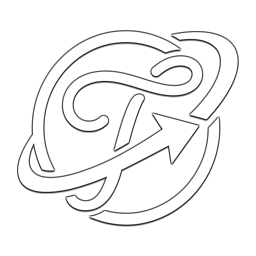

<p align="center">
  
</p>

<h1 align="center">Tessera Browser for Windows</h1>

<p align="center">
  <strong>Navegador minimalista, editorial e inteligente construído sobre Electron, React 19 e TypeScript.</strong><br>
  Com estética <em>Pure OLED & Editorial Journal</em>, Spaces isolados, Tessera AirBar flutuante, AdBlock nativo e IA integrada.
</p>

<p align="center">
  <a href="https://github.com/beyonder96/Tessera-Browser-Windows/releases/latest">
    
  </a>
  <a href="https://github.com/beyonder96/Tessera-Browser-Windows/releases/latest">
    
  </a>
  <a href="LICENSE">
    
  </a>
  
  
  
</p>

---

## 📥 Download & Instalação

Escolha uma das opções abaixo para baixar e começar a usar o **Tessera Browser** no seu computador Windows:

<p align="center">
  <br>
  <a href="https://github.com/beyonder96/Tessera-Browser-Windows/releases/download/v1.0.0/Tessera-Browser-Setup-1.0.0.exe">
    
  </a>
  &nbsp;&nbsp;&nbsp;&nbsp;
  <a href="https://github.com/beyonder96/Tessera-Browser-Windows/releases/download/v1.0.0/Tessera-Browser-Portable-1.0.0.exe">
    
  </a>
  &nbsp;&nbsp;&nbsp;&nbsp;
  <a href="https://github.com/beyonder96/Tessera-Browser-Windows/releases/latest">
    
  </a>
  <br><br>
</p>

### 📦 Opções de Distribuição

| Modalidade | Arquivo | Plataforma | Tamanho | Descrição |
| :--- | :--- | :--- | :--- | :--- |
| **Instalador Oficial (NSIS)** | [`Tessera-Browser-Setup-1.0.0.exe`](https://github.com/beyonder96/Tessera-Browser-Windows/releases/download/v1.0.0/Tessera-Browser-Setup-1.0.0.exe) | Windows 10/11 64-bit | ~85 MB | Cria atalhos na Área de Trabalho e no Menu Iniciar, associa protocolos web e permite desinstalação padrão. |
| **Executável Portátil** | [`Tessera-Browser-Portable-1.0.0.exe`](https://github.com/beyonder96/Tessera-Browser-Windows/releases/download/v1.0.0/Tessera-Browser-Portable-1.0.0.exe) | Windows 10/11 64-bit | ~85 MB | Não requer instalação nem privilégios de administrador. Pronto para rodar diretamente ou levar em um pendrive. |

> [!TIP]
> **Instalação Rápida no Windows:** Ao baixar o instalador ou portátil pela primeira vez, caso o *Windows SmartScreen* exiba a mensagem de aplicativo não reconhecido, basta clicar em **"Mais informações"** e em seguida em **"Executar assim mesmo"**.

---

## 🌟 Principais Recursos

### 🎈 Janela Frameless & Tessera AirBar Flutuante
- **Design Dinâmico:** Na Start Page, a interface recolhe-se em uma lupa circular minimalista de `56px`; durante a navegação, expande-se em uma cápsula de `680px` com barra de abas em pílulas.
- **Posicionamento Flexível:** Fixe a AirBar no rodapé (estilo mobile ergonômico) ou no topo clássico.
- **Auto-Hide Inteligente:** Recolhe-se suavemente ao rolar o conteúdo para dar 100% de foco à leitura.

### 🗂️ Arc Spaces com Sessões Isoladas
- **Perfis de Trabalho, Pessoal & Customizados:** Cada espaço opera em sua própria partição Chromium independente (`persist:space_<id>`), mantendo cookies, sessões e logins totalmente isolados.
- **Modo Anônimo Stealth:** Partição volátil em memória (`incognito_memory`), sem gravação em disco e com bloqueio por PIN opcional.

### 🛡️ Escudo de Privacidade & AdBlock Nativo
- **Bloqueio em Nível de Rede:** Interceptação ultra-rápida via `webRequest.onBeforeRequest` bloqueando domínios de telemetria, anúncios e rastreadores antes mesmo do download.
- **Cosmetic Filtering & Cookie Cleaner:** Remoção de banners de consentimento intrusivos e limpeza cosmética no DOM.
- **Painel de Métricas:** Contador em tempo real de anúncios bloqueados, dados de banda economizados e tempo ganho.

### 📖 Modo Leitura Editorial & Podcastify TTS
- **Leitura Sem Distrações:** Extração instantânea do corpo principal de artigos com tipografia editorial.
- **4 Temas Exclusivos:** *Jornal Editorial (`#F7F4EB`)*, *Sépia Vintage*, *Escuro Suave* e *Pure OLED (`#000000`)*.
- **Podcastify TTS:** Player de voz integrado que lê artigos em voz alta usando síntese neural local em português (`AudioTextNormalizer`).

### 🤖 Tessera Intelligence (Gemini & Groq)
- **Assistente Lateral Integrado:** Resuma páginas com um clique, faça perguntas sobre o conteúdo ou selecione trechos para explicações instantâneas.
- **Segurança de Nível Corporativo:** As chaves de API são protegidas nativamente pela **Windows DPAPI** via `safeStorage` do Electron.

### 📲 Ponte Wi-Fi Local (Android ↔ Windows)
- **Sincronização Direta sem Nuvem:** Conecte seu PC ao **Tessera Browser Android** escaneando um QR Code gerado pelo servidor HTTP local do app.
- **Troca de Abas & Backups:** Envie URLs instantaneamente entre o celular e o PC e importe/exporte seus favoritos e históricos via arquivos `tessera_backup_*.json`.

---

## ⌨️ Atalhos de Teclado no Windows

| Atalho | Ação |
| :--- | :--- |
| `Ctrl + L` ou `Alt + D` | Expandir e focar a **Tessera AirBar** |
| `Ctrl + T` | Abrir nova guia no Espaço ativo |
| `Ctrl + W` | Fechar guia ativa |
| `Ctrl + Shift + T` | Reabrir última guia fechada |
| `Ctrl + Tab` / `Ctrl + Shift + Tab` | Alternar entre guias abertas |
| `Ctrl + 1` até `Ctrl + 9` | Mudar diretamente para a aba correspondente |
| `Ctrl + Shift + N` | Entrar no Modo Anônimo Stealth |
| `Alt + R` | Alternar Modo Leitura Editorial |
| `Alt + A` | Abrir painel do Tessera AI Assistant |
| `Alt + Clique em Link` | Abrir **Peek Preview** flutuante |
| `Ctrl + F` | Buscar texto na página |
| `F5` ou `Ctrl + R` | Recarregar página atual |
| `F12` | Abrir Chromium DevTools |

---

## 🛠️ Tecnologias Utilizadas

- **Núcleo Desktop:** [Electron 34](https://www.electronjs.org/) (Chromium Multi-Process + Node.js)
- **Interface & Componentes:** [React 19](https://react.dev/), [TypeScript 5.7](https://www.typescriptlang.org/), [Lucide React](https://lucide.dev/)
- **Build & Bundler:** [Vite 6](https://vitejs.dev/), [vite-plugin-electron](https://github.com/electron-vite/vite-plugin-electron)
- **Empacotamento Windows:** [electron-builder 25](https://www.electron.build/) (Instalador NSIS + Executável Portátil)
- **Testes Unitários:** [Vitest](https://vitest.dev/)

---

## 💻 Como Rodar e Compilar Localmente

### Pré-requisitos
- **Node.js** (v18 ou superior)
- **npm** (v9 ou superior)
- Sistema operacional Windows 10 ou 11 (para build nativo)

### Passos de Instalação

```powershell
# 1. Clonar o repositório
git clone https://github.com/beyonder96/Tessera-Browser-Windows.git
cd Tessera-Browser-Windows

# 2. Instalar dependências
npm install

# 3. Executar em modo desenvolvimento (Live Reload)
npm run dev
```

### Validação de Código e Testes

```powershell
# Checagem de tipos estáticos
npm run typecheck

# Execução da suíte de testes unitários
npm run test
```

### Geração dos Binários de Produção

```powershell
# Gera o instalador NSIS (.exe) e o executável Portátil (.exe) na pasta release/
npm run build:win
```

---

## 📄 Licença

Este projeto é distribuído sob a licença **MIT**. Consulte o arquivo [LICENSE](LICENSE) para mais detalhes.

---

<p align="center">
  Desenvolvido com carinho como parte do <strong>Tessera Ecosystem</strong>.
</p>
